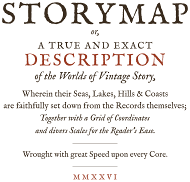
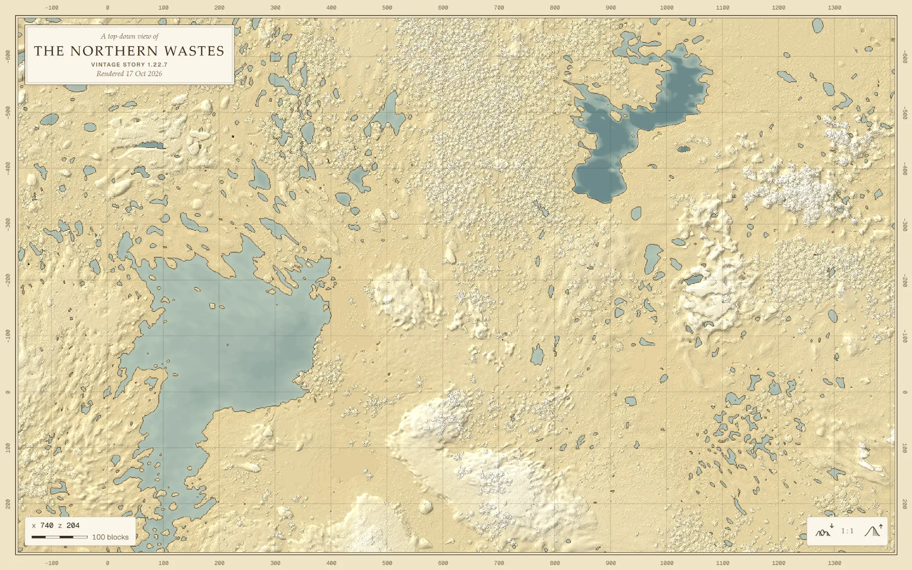

<p align="center">
	<picture>
		<source media="(prefers-color-scheme: dark)" srcset="docs/images/title-dark.svg">
		
	</picture>
</p>

<p align="center">
	
</p>

<h1 align="center">🗺️ Storymap: High Performance Vintage Story Map Renderer ⚡️</h1>

- **Fast.** Close to 100,000 chunks a second, using every core.
- **Made to explore.** Pan and zoom in your browser, from one page that opens straight from the folder: no server, nothing to install.
- **Drawn like a printed map.** Sepia relief with hill shading, inked coastlines, a grid in the game's own coordinates and a title cartouche.
- **Gentle with your saves.** Storymap opens them read-only and never writes next to them.

<h2 align="center">Getting started</h2>

1. Install [Zig 0.17.0](https://ziglang.org/download/).
2. Render a save:

	```bash
	git clone https://github.com/MadrasMC/storymap
	cd storymap
	zig build run -Doptimize=ReleaseFast -- path/to/save.vcdbs out
	```

	Saves are in the game's data folder, under `Saves/` (`%APPDATA%\VintagestoryData\Saves` on Windows). Add `--theme plain` for a simpler page, with the map drawn as the game draws its own, or [make your own](docs/themes.md).
3. Open `out/index.html` in your browser.

Tested with saves from Vintage Story 1.19 and 1.22.7.

<h2 align="center">Documentation</h2>

- **[Save format](docs/save-format/README.md):** the `.vcdbs` format as far as Storymap has worked it out, from the SQLite schema to block palettes and block entities. Every claim is marked with its source: verified against a real save, read in the game's open-source code, from the wiki, or unverified.
- **[Rendering](docs/rendering.md):** how the map is drawn, how it's split into tiles for the viewer, and where the time goes.
- **[Themes](docs/themes.md):** choosing the page drawn around the map, or writing your own.
- **[What's next](TODO.md):** block colours, an isometric render and more.

<h2 align="center">Performance</h2>

A render of a 1.22.7 world (29,192 chunks, drawn as 34 tiles in 5 levels), ReleaseFast on a 14-thread machine, the median of 7 runs:

| Stage | Time |
| --- | --- |
| Opening the save | 0.016 s |
| Drawing every tile: reading the surface, shading, building the zoomed-out levels and encoding the PNGs | 0.30 s |
| End to end | 0.31 s (93,500 chunks/s) |
| For comparison, decoding every chunk once | 0.45 s |

Storymap reads only the chunks that hold the surface, so drawing the whole map takes less time than decoding the save.

To measure your own save:

```bash
zig build bench -Doptimize=ReleaseFast -- path/to/save.vcdbs [runs]
```

More numbers and what they mean: [`docs/rendering.md`](docs/rendering.md#performance).

<h2 align="center">License</h2>

<p align="center">MIT, see <a href="LICENSE">LICENSE</a>.</p>
