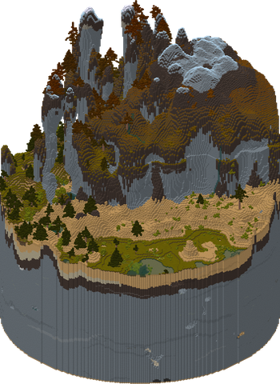
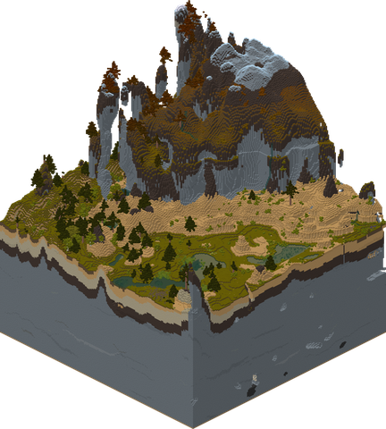
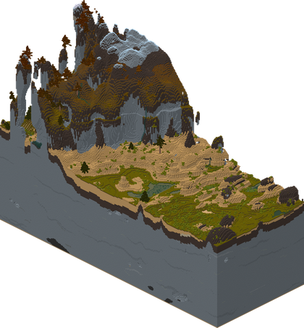

# Usage

`storymap --help` lists every option.

## Clipping

Use `--clip` to draw a part of a world. 3 shapes are supported, as in the table below.

|Shape| **circle** | **square** | **rectangle** |
|---| --- | --- | --- |
|Syntax| `circle:radius@x,z` | `square:side@x,z` | `rect:widthxheight@x,z` or `rect:x,z..x,z` |
|Example| `--clip circle:100@196,-5964` | `--clip square:200@222,-5938` | `--clip rect:300x120@272,-5978` |
|Render|  |  |  |

> Examples drawn with `--isometric --theme plain`.
